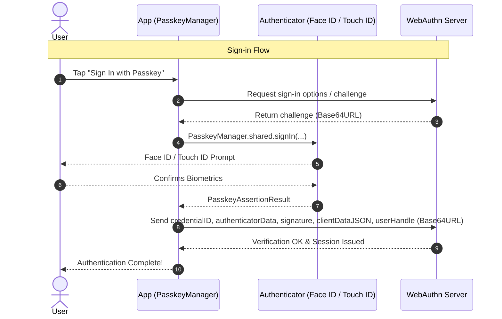

# PasskeyManager

[](https://swift.org)
[](#-requirements)
[](https://swift.org/package-manager/)
[](https://www.swift.org/documentation/concurrency/)
[](LICENSE)

A lightweight, Swift 6 strict-concurrency-safe `async`/`await` wrapper around Apple's **AuthenticationServices** platform passkey (WebAuthn / FIDO2) APIs.

Handles registration, explicit sign-in, and passive AutoFill (Conditional UI) with zero third-party dependencies.

---

## ✨ Features

- 🔑 **Complete WebAuthn Ceremony**: Support for both credential creation (registration) and assertion (sign-in) ceremonies.
- ⚡ **AutoFill / Conditional UI**: Passive passkey suggestions directly in the QuickType keyboard bar on iOS & visionOS.
- 🛡️ **Swift 6 Strict Concurrency**: Fully `@MainActor`-isolated and `Sendable`-checked with zero compiler warnings.
- 🚫 **Leak-Free Cancellation**: Cancelling the calling `Task` dismisses the system sheet and throws `CancellationError`, so it's never confused with the user tapping Cancel.
- 🎯 **Credential Filtering**: `excludedCredentialIDs` on registration and `allowedCredentialIDs` on sign-in map to WebAuthn's `excludeCredentials` / `allowCredentials`.
- 🌐 **Built-in Base64URL (RFC 4648 §5)**: Native encoding/decoding and convenience properties on result payloads for direct WebAuthn JSON interoperability.
- 🪟 **Smart Window Presentation Anchoring**: Automatically detects active foreground scenes on Stage Manager, multi-window iPadOS, and visionOS.
- 🪶 **Zero Dependencies**: Pure Apple platform framework integration (`AuthenticationServices`).

---

## 📋 Requirements

- **Platforms**: iOS 16.0+, macOS 13.0+, visionOS 1.0+ (enforced via `@available`)
  - *Note:* AutoFill / Conditional UI is supported on iOS and visionOS. On macOS and Mac Catalyst, button-triggered passkey sign-in is used.
- **Toolchain**: Xcode 16+, Swift 6 language mode
- **Domain**: An HTTPS domain you control hosting an `apple-app-site-association` file
- **Server**: Any standard WebAuthn-compliant backend

---

## 📦 Installation

### Swift Package Manager (SPM)

Add the dependency to your `Package.swift`:

**Option 1: Tagged release (recommended)**
```swift
dependencies: [
    .package(url: "https://github.com/bhargavkukadiya/PasskeyManager.git", from: "1.0.0")
]
```

**Option 2: Main branch directly**
```swift
dependencies: [
    .package(url: "https://github.com/bhargavkukadiya/PasskeyManager.git", branch: "main")
]
```

### Xcode

1. In Xcode, select **File** → **Add Package Dependencies...**
2. Enter repository URL: `https://github.com/bhargavkukadiya/PasskeyManager.git`
3. Select your version rules and add `PasskeyManager` to your target.

### Manual Drop-in

Alternatively, you can drag and drop `Sources/PasskeyManager/PasskeyManager.swift` directly into your Xcode project.

---

## ⚙️ 1. App & Domain Setup

Passkeys are scoped to a **relying party identifier** (your domain, e.g. `example.com`) and require Apple to verify your app's association.

### a. Add Associated Domains Capability
In your target's **Signing & Capabilities**, add **Associated Domains** and add:
```text
webcredentials:example.com
```

### b. Host `apple-app-site-association`
At `https://example.com/.well-known/apple-app-site-association` (no file extension, served over HTTPS with `application/json`, no redirects):

```json
{
  "webcredentials": {
    "apps": ["TEAMID.com.yourcompany.yourapp"]
  }
}
```
*Replace `TEAMID` with your Apple Developer Team ID and `com.yourcompany.yourapp` with your App Bundle ID.*

### c. Sharing Passkeys with Your Website
No extra AASA entry is needed. The `webcredentials` entry above is what lets your app use passkeys for `example.com`, and those are the same passkeys Safari uses on `https://example.com`, synced through iCloud Keychain. Just make sure your website and app use the same relying party identifier.

---

## 🔄 2. The WebAuthn Ceremony



---

## 🚀 3. Usage Guide

### Registration (Creating a Passkey)

Pass the Base64URL strings received from your backend directly:

```swift
guard let anchor = PasskeyManager.keyWindowAnchor() else { return }

let result = try await PasskeyManager.shared.register(
    relyingPartyIdentifier: "example.com",
    userName: "alex_appleseed",
    userIDBase64URL: serverResponse.userID,
    challengeBase64URL: serverResponse.challenge,
    // Optional: the account's existing credential IDs (WebAuthn excludeCredentials),
    // so the same device can't register a duplicate passkey. iOS 18 / macOS 15+.
    excludedCredentialIDsBase64URL: serverResponse.excludeCredentials,
    anchor: anchor
)

// Send Base64URL payloads to your backend
try await api.finishRegistration(
    credentialID: result.credentialIDBase64URL,
    attestationObject: result.rawAttestationObjectBase64URL,
    clientDataJSON: result.rawClientDataJSONBase64URL
)
```

### Sign-in (Button Tap)

```swift
guard let anchor = PasskeyManager.keyWindowAnchor() else { return }

let result = try await PasskeyManager.shared.signIn(
    relyingPartyIdentifier: "example.com",
    challengeBase64URL: serverResponse.challenge,
    anchor: anchor
)

// Send assertion to your backend
try await api.finishSignIn(
    credentialID: result.credentialIDBase64URL,
    authenticatorData: result.rawAuthenticatorDataBase64URL,
    signature: result.signatureBase64URL,
    clientDataJSON: result.rawClientDataJSONBase64URL,
    // Identifies the account when the user picked a passkey without typing a username
    userHandle: result.userIDBase64URL
)
```

If the user has already entered a username, pass that account's credential IDs as `allowedCredentialIDsBase64URL:` (WebAuthn `allowCredentials`) to restrict the sheet to them.

### Sign-in When the Screen Appears

With `preferImmediatelyAvailableCredentials: true`, the sheet only appears if a passkey is already on this device. Otherwise it shows nothing and throws `.cancelled` straight away, so you can fall back to your password form:

```swift
do {
    let result = try await PasskeyManager.shared.signIn(
        relyingPartyIdentifier: "example.com",
        challengeBase64URL: serverResponse.challenge,
        anchor: anchor,
        preferImmediatelyAvailableCredentials: true
    )
    // Finish sign-in with your backend
} catch PasskeyError.cancelled {
    // No passkey on this device, or the user dismissed the sheet
    showPasswordForm()
}
```

### Sign-in with AutoFill (Conditional UI - iOS / visionOS)

Mark your username field with `.textContentType(.username)` and trigger AutoFill in `.task`:

```swift
TextField("Username", text: $username)
    .textContentType(.username)
```

```swift
.task {
    guard let anchor = PasskeyManager.keyWindowAnchor() else { return }
    do {
        let result = try await PasskeyManager.shared.beginAutoFillAssistedSignIn(
            relyingPartyIdentifier: "example.com",
            challengeBase64URL: challengeString,
            anchor: anchor
        )
        await handleSignInSuccess(result)
    } catch is CancellationError {
        // View disappeared or Task cancelled — ignore
    } catch PasskeyError.cancelled {
        // Superseded by an explicit signIn/register, or cancelAutoFillAssistedSignIn()
    } catch {
        // Handle error
    }
}
```

`signIn(...)` and `register(...)` cancel any in-flight AutoFill request before showing their sheet. AutoFill isn't restarted automatically, so start it again if the user comes back to the username field.

---

## 📱 4. Complete SwiftUI Example

```swift
import SwiftUI
import PasskeyManager

struct SignInView: View {
    @State private var username = ""
    @State private var statusMessage = ""

    var body: some View {
        NavigationStack {
            Form {
                Section("Sign In") {
                    TextField("Username", text: $username)
                        .textContentType(.username)
                        .autocorrectionDisabled()
                        .textInputAutocapitalization(.never)

                    Button("Sign In with Passkey") {
                        Task { await performExplicitSignIn() }
                    }
                }

                if !statusMessage.isEmpty {
                    Section {
                        Text(statusMessage)
                            .font(.footnote)
                    }
                }
            }
            .navigationTitle("Welcome")
            // Passive AutoFill / Conditional UI
            .task {
                await performAutoFillSignIn()
            }
        }
    }

    private func performExplicitSignIn() async {
        guard let anchor = PasskeyManager.keyWindowAnchor() else { return }
        do {
            let challenge = try await api.fetchSignInChallenge()
            let assertion = try await PasskeyManager.shared.signIn(
                relyingPartyIdentifier: "example.com",
                challengeBase64URL: challenge,
                anchor: anchor
            )
            try await api.completeSignIn(assertion: assertion)
            statusMessage = "Signed in successfully!"
        } catch PasskeyError.cancelled {
            // User cancelled — no need to show an alert
        } catch {
            statusMessage = "Sign-in error: \(error.localizedDescription)"
        }
    }

    private func performAutoFillSignIn() async {
        guard PasskeyCapability.isAutoFillSupported,
              let anchor = PasskeyManager.keyWindowAnchor() else { return }
        do {
            let challenge = try await api.fetchSignInChallenge()
            let assertion = try await PasskeyManager.shared.beginAutoFillAssistedSignIn(
                relyingPartyIdentifier: "example.com",
                challengeBase64URL: challenge,
                anchor: anchor
            )
            try await api.completeSignIn(assertion: assertion)
            statusMessage = "AutoFill sign-in successful!"
        } catch is CancellationError {
            // View disappeared
        } catch PasskeyError.cancelled, PasskeyError.noCredentialsAvailable {
            // Superseded by the button, or nothing to offer — expected during AutoFill
        } catch {
            statusMessage = "Sign-in error: \(error.localizedDescription)"
        }
    }
}
```

---

## 📚 5. API Reference

| Symbol | Description |
|---|---|
| `PasskeyManager.shared.register(...)` | Creates a new passkey with biometric/passcode confirmation |
| `PasskeyManager.shared.signIn(...)` | Authenticates existing passkey via explicit sheet |
| `PasskeyManager.shared.beginAutoFillAssistedSignIn(...)` | Passive AutoFill request tied to QuickType bar (iOS/visionOS) |
| `PasskeyManager.shared.cancelAutoFillAssistedSignIn()` | Cancels an in-flight AutoFill request |
| `PasskeyManager.keyWindowAnchor()` | Retrieves a foreground window as the presentation anchor (not available in app extensions) |
| `PasskeyCapability.isSupported` | Checks OS passkey support from pre-iOS 16 code. Only useful with the manual drop-in: via SPM the package already requires iOS 16 / macOS 13, so it's always `true` |
| `PasskeyCapability.isAutoFillSupported` | Checks if AutoFill passkey flow is supported on current OS & platform |
| `Base64URL.encode(_:)` / `.decode(_:)` | Encodes/decodes between `Data` and RFC 4648 §5 Base64URL |
| `PasskeyRegistrationResult` | Registration output payload with `Data` and `Base64URL` accessors |
| `PasskeyAssertionResult` | Assertion output payload with `Data` and `Base64URL` accessors |
| `PasskeyError` | Typed `LocalizedError` failures (`.cancelled`, `.noCredentialsAvailable`, etc.) |

---

## ⚠️ 6. Error Handling

| Error | Typical Cause | Recommended Action |
|---|---|---|
| `CancellationError` | The calling `Task` was cancelled (e.g. the view disappeared) | Ignore silently |
| `.cancelled` | User dismissed the sheet; **or** `preferImmediatelyAvailableCredentials: true` found no passkey on this device; **or** an AutoFill request was superseded | With `preferImmediatelyAvailableCredentials`, fall back to your password form; otherwise ignore |
| `.noCredentialsAvailable` | The system didn't handle the request (`ASAuthorizationError.notHandled`) | Fall back to another sign-in method |
| `.unexpectedCredentialType` | Authorization returned an unexpected credential type | Log diagnostic error |
| `.missingAttestationObject` | Registration response lacked attestation data | Check authenticator configuration |
| `.credentialAlreadyRegistered` | Registration matched one of `excludedCredentialIDs` | Tell the user they already have a passkey |
| `.invalidChallenge` | Failed to Base64URL-decode server challenge | Verify backend challenge encoding |
| `.invalidUserID` | Failed to Base64URL-decode server user handle | Verify backend user ID encoding |
| `.invalidCredentialID` | Failed to Base64URL-decode an allowed/excluded credential ID | Verify backend credential ID encoding |
| `.underlying(error)` | Any other error, e.g. an `ASAuthorizationError` with code `.failed` (often an Associated Domains misconfiguration) | Inspect `error` — cast to `ASAuthorizationError` to check its `code` |

---

## 🧪 7. Testing Notes

- **Simulator**: Passkeys are supported in the Simulator, but requires signing into an iCloud account with Two-Factor Authentication and iCloud Keychain enabled (**Settings** → **[Your Name]** → **iCloud** → **Passwords & Keychain**).
- **Physical Device**: Always verify on a physical device prior to production — Associated Domain cache propagation and biometric prompts are most representative on hardware.
- **Resetting Test Passkeys**: On your test device, navigate to **Settings** → **Passwords**, search for your test domain, and delete the passkey.

---

## 🤝 Contributing

Contributions, bug reports, and feature requests are welcome! Feel free to check the [Issues](https://github.com/bhargavkukadiya/PasskeyManager/issues) page.

---

## 📄 License

This project is licensed under the MIT License — see the [LICENSE](LICENSE) file for details.
