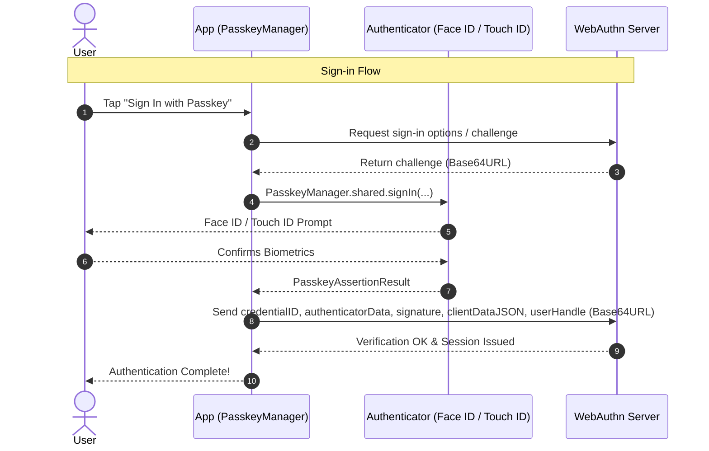

# PasskeyManager

[](https://swift.org)
[](#-requirements)
[](https://swift.org/package-manager/)
[](https://www.swift.org/documentation/concurrency/)
[](LICENSE)

A lightweight, Swift 6 strict-concurrency-safe `async`/`await` wrapper around Apple's **AuthenticationServices** platform passkey (WebAuthn / FIDO2) APIs.

Handles registration, explicit sign-in, and passive AutoFill (Conditional UI) with zero third-party dependencies.

---

## ✨ Features

- 🔑 **Complete WebAuthn Ceremony**: Support for both credential creation (registration) and assertion (sign-in) ceremonies.
- ⚡ **AutoFill / Conditional UI**: Passive passkey suggestions directly in the QuickType keyboard bar on iOS & visionOS.
- 🛡️ **Swift 6 Strict Concurrency**: Fully `@MainActor`-isolated and `Sendable`-checked with zero compiler warnings.
- 🚫 **Leak-Free Cancellation**: Cancelling the calling `Task` cancels a pending authorization and throws `CancellationError`. A successful authorization that wins the cancellation race is still returned.
- 🎯 **Credential Filtering**: `excludedCredentialIDs` on registration and `allowedCredentialIDs` on sign-in map to WebAuthn's `excludeCredentials` / `allowCredentials`.
- 🌐 **Built-in Base64URL (RFC 4648 §5)**: Native encoding/decoding and convenience properties on result payloads for direct WebAuthn JSON interoperability.
- 🪟 **Smart Window Presentation Anchoring**: Automatically detects active foreground scenes on Stage Manager, multi-window iPadOS, and visionOS.
- 🪶 **Zero Dependencies**: Pure Apple platform framework integration (`AuthenticationServices`).

---

## 📋 Requirements

- **Platforms**: iOS 16.0+, macOS 13.0+, visionOS 1.0+ (enforced via `@available`)
  - *Note:* AutoFill / Conditional UI is supported on iOS and visionOS. On macOS and Mac Catalyst, button-triggered passkey sign-in is used.
- **Toolchain**: Xcode 16+, Swift 6 language mode
- **Domain**: An HTTPS domain you control hosting an `apple-app-site-association` file
- **Server**: Any standard WebAuthn-compliant backend

---

## 📦 Installation

### Swift Package Manager (SPM)

Add the dependency to your `Package.swift`:

These examples target `2.0.0`, which includes breaking API changes. If you're upgrading from `1.0.0`, follow the [migration guide](#migrating-from-100-to-200).

**Option 1: Tagged release**
```swift
dependencies: [
    .package(url: "https://github.com/bhargavkukadiya/PasskeyManager.git", from: "2.0.0")
]
```

**Option 2: Main branch directly**
```swift
dependencies: [
    .package(url: "https://github.com/bhargavkukadiya/PasskeyManager.git", branch: "main")
]
```

### Xcode

1. In Xcode, select **File** → **Add Package Dependencies...**
2. Enter repository URL: `https://github.com/bhargavkukadiya/PasskeyManager.git`
3. Select your version rules and add `PasskeyManager` to your target.

### Manual Drop-in

Alternatively, you can drag and drop `Sources/PasskeyManager/PasskeyManager.swift` directly into your Xcode project.

With a lower deployment target, guard calls to `PasskeyManager` with `if #available(iOS 16.0, macOS 13.0, visionOS 1.0, *)`. `PasskeyCapability.isSupported` reports OS availability only; it doesn't check saved passkeys, credential provider setup, or Associated Domains configuration.

### Migrating from 1.0.0 to 2.0.0

- Handle `CancellationError` separately from `PasskeyError.cancelled`: task cancellation now resumes the caller directly, including when a failure callback arrives before the cancellation handler runs. A successful authorization that arrives first is still returned.
- `PasskeyError.underlying` now contains `any Error` instead of `String`. Use `error.localizedDescription` for display, or cast to `ASAuthorizationError` to inspect its code. Non-authorization errors delivered by the controller are also wrapped in `.underlying`.
- `Base64URL.decode(_:)` now rejects the standard-Base64 characters `+` and `/`. Send Base64URL using `-` and `_`; trailing `=` padding remains optional.
- Update exhaustive `PasskeyError` switches for the new `.credentialAlreadyRegistered` and `.invalidCredentialID` cases.
- On iOS, Mac Catalyst and visionOS, `PasskeyManager.keyWindowAnchor()` is now unavailable in app extensions; pass the extension's own window as the anchor instead. On those platforms it also returns `nil` when no scene is in the foreground, instead of falling back to a backgrounded scene's window. The macOS (AppKit) version is unchanged.
- `signIn(...)` and `register(...)` now cancel an in-flight AutoFill request, which then throws `PasskeyError.cancelled`. Treat that as expected in your AutoFill handler, and start AutoFill again if the user stays on the sign-in screen.

---

## ⚙️ 1. App & Domain Setup

Passkeys are scoped to a **relying party identifier** (your domain, e.g. `example.com`) and require Apple to verify your app's association.

### a. Add Associated Domains Capability
In your target's **Signing & Capabilities**, add **Associated Domains** and add:
```text
webcredentials:example.com
```

### b. Host `apple-app-site-association`
At `https://example.com/.well-known/apple-app-site-association` (no file extension, served over HTTPS with `application/json`, no redirects):

```json
{
  "webcredentials": {
    "apps": ["TEAMID.com.yourcompany.yourapp"]
  }
}
```
*Replace `TEAMID` with your Apple Developer Team ID and `com.yourcompany.yourapp` with your App Bundle ID.*

### c. Sharing Passkeys with Your Website
No extra AASA entry is needed. The `webcredentials` entry above is what lets your app use passkeys for `example.com`, and those are the same passkeys Safari uses on `https://example.com`, synced through iCloud Keychain. Just make sure your website and app use the same relying party identifier.

---

## 🔄 2. The WebAuthn Ceremony



---

## 🚀 3. Usage Guide

Call `PasskeyManager` and its window helper from the main actor, for example from SwiftUI UI code or an `@MainActor` function. The examples use an app-defined `api` client and decoded server responses; replace them with your backend integration.

### Registration (Creating a Passkey)

Pass the Base64URL strings received from your backend directly:

```swift
guard let anchor = PasskeyManager.keyWindowAnchor() else { return }

let result = try await PasskeyManager.shared.register(
    relyingPartyIdentifier: "example.com",
    userName: "alex_appleseed",
    userIDBase64URL: serverResponse.userID,
    challengeBase64URL: serverResponse.challenge,
    // Optional: extract the Base64URL id from each WebAuthn excludeCredentials entry.
    excludedCredentialIDsBase64URL: serverResponse.excludeCredentials.map(\.id),
    anchor: anchor
)

// Send Base64URL payloads to your backend
try await api.finishRegistration(
    credentialID: result.credentialIDBase64URL,
    attestationObject: result.rawAttestationObjectBase64URL,
    clientDataJSON: result.rawClientDataJSONBase64URL
)
```

`excludedCredentialIDsBase64URL` takes an array of ID strings, not the full WebAuthn credential descriptor objects. Exclusion is applied by this library on iOS / Mac Catalyst 18+ and macOS 15+. It is ignored on earlier OS versions and on all visionOS versions. On those platforms, passing a non-empty list does not prevent registration.

### Sign-in (Button Tap)

```swift
guard let anchor = PasskeyManager.keyWindowAnchor() else { return }

let result = try await PasskeyManager.shared.signIn(
    relyingPartyIdentifier: "example.com",
    challengeBase64URL: serverResponse.challenge,
    anchor: anchor
)

// Send assertion to your backend
try await api.finishSignIn(
    credentialID: result.credentialIDBase64URL,
    authenticatorData: result.rawAuthenticatorDataBase64URL,
    signature: result.signatureBase64URL,
    clientDataJSON: result.rawClientDataJSONBase64URL,
    // Identifies the account when the user picked a passkey without typing a username
    userHandle: result.userIDBase64URL
)
```

If the user has already entered a username, pass that account's credential IDs as `allowedCredentialIDsBase64URL:` (WebAuthn `allowCredentials`) to restrict the sheet to them. For standard WebAuthn options, extract the IDs with `serverResponse.allowCredentials.map(\.id)`. An empty list allows any passkey for the relying party. This filter is available on all supported platforms. The `Data` overloads accept `allowedCredentialIDs:` and `excludedCredentialIDs:` instead.

### Sign-in When the Screen Appears

With `preferImmediatelyAvailableCredentials: true`, the sheet only appears if a matching passkey is immediately available on this device. Otherwise it shows nothing and throws `.cancelled`, so you can fall back to your password form. This also applies when no passkey matches `allowedCredentialIDs`. See Apple's [modal passkey request guidance](https://developer.apple.com/videos/play/wwdc2022/10092/).

```swift
do {
    let result = try await PasskeyManager.shared.signIn(
        relyingPartyIdentifier: "example.com",
        challengeBase64URL: serverResponse.challenge,
        anchor: anchor,
        preferImmediatelyAvailableCredentials: true
    )
    // Finish sign-in with your backend
} catch is CancellationError {
    // The calling Task was cancelled — leave the screen's fallback UI alone
} catch PasskeyError.cancelled {
    // No passkey on this device, or the user dismissed the sheet
    showPasswordForm()
}
```

### Sign-in with AutoFill (Conditional UI - iOS / visionOS)

Mark your username field with `.textContentType(.username)` and trigger AutoFill in `.task`:

```swift
TextField("Username", text: $username)
    .textContentType(.username)
```

```swift
.task {
    guard let anchor = PasskeyManager.keyWindowAnchor() else { return }
    do {
        let result = try await PasskeyManager.shared.beginAutoFillAssistedSignIn(
            relyingPartyIdentifier: "example.com",
            challengeBase64URL: challengeString,
            anchor: anchor
        )
        await handleSignInSuccess(result)
    } catch is CancellationError {
        // View disappeared or Task cancelled — ignore
    } catch PasskeyError.cancelled {
        // Superseded by an explicit signIn/register, or cancelAutoFillAssistedSignIn()
    } catch {
        // Handle error
    }
}
```

`signIn(...)` and `register(...)` cancel any in-flight AutoFill request before showing their sheet. AutoFill isn't restarted automatically, so start it again if the user comes back to the username field.

---

## 📱 4. Complete SwiftUI Example (iOS / visionOS)

This example uses the iOS / visionOS AutoFill API. On macOS and Mac Catalyst, use explicit `signIn(...)` instead; a runtime capability check cannot make the AutoFill method available there. Supply your own `api` client; here `fetchSignInChallenge()` returns a Base64URL string and `completeSignIn(assertion:)` verifies the assertion with your server.

```swift
import SwiftUI
import PasskeyManager

struct SignInView: View {
    @State private var username = ""
    @State private var statusMessage = ""
    /// Bumped to restart AutoFill after the explicit sheet cancels it.
    @State private var autoFillAttempt = 0

    var body: some View {
        NavigationStack {
            Form {
                Section("Sign In") {
                    TextField("Username", text: $username)
                        .textContentType(.username)
                        .autocorrectionDisabled()
                        .textInputAutocapitalization(.never)

                    Button("Sign In with Passkey") {
                        Task { await performExplicitSignIn() }
                    }
                }

                if !statusMessage.isEmpty {
                    Section {
                        Text(statusMessage)
                            .font(.footnote)
                    }
                }
            }
            .navigationTitle("Welcome")
            // Passive AutoFill / Conditional UI. Restarts whenever
            // autoFillAttempt changes, and is cancelled when the view disappears.
            .task(id: autoFillAttempt) {
                await performAutoFillSignIn()
            }
        }
    }

    private func performExplicitSignIn() async {
        guard let anchor = PasskeyManager.keyWindowAnchor() else { return }
        do {
            let challenge = try await api.fetchSignInChallenge()
            let assertion = try await PasskeyManager.shared.signIn(
                relyingPartyIdentifier: "example.com",
                challengeBase64URL: challenge,
                anchor: anchor
            )
            try await api.completeSignIn(assertion: assertion)
            statusMessage = "Signed in successfully!"
        } catch is CancellationError {
            // The calling Task was cancelled
        } catch PasskeyError.cancelled {
            // User cancelled — no need to show an alert.
            // signIn(...) cancelled AutoFill, so start it again.
            autoFillAttempt += 1
        } catch {
            statusMessage = "Sign-in error: \(error.localizedDescription)"
            autoFillAttempt += 1
        }
    }

    private func performAutoFillSignIn() async {
        guard PasskeyCapability.isAutoFillSupported,
              let anchor = PasskeyManager.keyWindowAnchor() else { return }
        do {
            let challenge = try await api.fetchSignInChallenge()
            let assertion = try await PasskeyManager.shared.beginAutoFillAssistedSignIn(
                relyingPartyIdentifier: "example.com",
                challengeBase64URL: challenge,
                anchor: anchor
            )
            try await api.completeSignIn(assertion: assertion)
            statusMessage = "AutoFill sign-in successful!"
        } catch is CancellationError {
            // View disappeared
        } catch PasskeyError.cancelled, PasskeyError.noCredentialsAvailable {
            // Superseded by the button, or nothing to offer — expected during AutoFill
        } catch {
            statusMessage = "Sign-in error: \(error.localizedDescription)"
        }
    }
}
```

---

## 📚 5. API Reference

| Symbol | Description |
|---|---|
| `PasskeyManager.shared.register(...)` | Creates a new passkey with biometric/passcode confirmation |
| `PasskeyManager.shared.signIn(...)` | Authenticates existing passkey via explicit sheet |
| `PasskeyManager.shared.beginAutoFillAssistedSignIn(...)` | Passive AutoFill request tied to QuickType bar (iOS/visionOS) |
| `PasskeyManager.shared.cancelAutoFillAssistedSignIn()` | Cancels an in-flight AutoFill request |
| `PasskeyManager.keyWindowAnchor()` | Retrieves a presentation window. On iOS, Mac Catalyst and visionOS it must be in a foreground scene, and the helper is unavailable in app extensions there |
| `PasskeyCapability.isSupported` | Checks OS passkey support from pre-iOS 16 code. Only useful with the manual drop-in: via SPM the package already requires iOS 16 / macOS 13, so it's always `true` |
| `PasskeyCapability.isAutoFillSupported` | Checks OS/platform availability of this library's AutoFill flow; doesn't check whether any credentials exist |
| `Base64URL.encode(_:)` / `.decode(_:)` | Encodes/decodes between `Data` and RFC 4648 §5 Base64URL |
| `PasskeyRegistrationResult` | Registration output payload with `Data` and `Base64URL` accessors |
| `PasskeyAssertionResult` | Assertion output payload with `Data` and `Base64URL` accessors |
| `PasskeyError` | Typed `LocalizedError` failures (`.cancelled`, `.noCredentialsAvailable`, etc.) |

---

## ⚠️ 6. Error Handling

Task cancellation and user dismissal are separate outcomes. Once input has been decoded, a cancelled request throws `CancellationError`; a failure callback racing with task cancellation also becomes `CancellationError`. If a successful authorization reaches the coordinator before cancellation completes, the result is returned. `signIn(...)` and `register(...)` do not restart AutoFill after cancelling it.

| Error | Typical Cause | Recommended Action |
|---|---|---|
| `CancellationError` | The calling `Task` was cancelled (e.g. the view disappeared) | Ignore silently |
| `.cancelled` | User dismissed the sheet; **or** `preferImmediatelyAvailableCredentials: true` found no passkey on this device; **or** an AutoFill request was superseded | With `preferImmediatelyAvailableCredentials`, fall back to your password form; otherwise ignore |
| `.noCredentialsAvailable` | The system didn't handle the request (`ASAuthorizationError.notHandled`) | Fall back to another sign-in method |
| `.unexpectedCredentialType` | Authorization returned an unexpected credential type | Log diagnostic error |
| `.missingAttestationObject` | Registration response lacked attestation data | Check authenticator configuration |
| `.credentialAlreadyRegistered` | Registration matched one of `excludedCredentialIDs` | Tell the user they already have a passkey |
| `.invalidChallenge` | Failed to Base64URL-decode server challenge | Verify backend challenge encoding |
| `.invalidUserID` | Failed to Base64URL-decode server user handle | Verify backend user ID encoding |
| `.invalidCredentialID` | Failed to Base64URL-decode an allowed/excluded credential ID | Verify backend credential ID encoding |
| `.underlying(error)` | Any other error, e.g. an `ASAuthorizationError` with code `.failed` (often an Associated Domains misconfiguration) | Inspect `error` — cast to `ASAuthorizationError` to check its `code` |

---

## 🧪 7. Testing Notes

Run the package's unit tests on macOS with Xcode selected as the active developer directory:

```sh
swift test
```

These tests cover Base64URL conversion, result payloads, error mapping, and coordinator cancellation. They simulate delegate callbacks and do not perform a live passkey ceremony or validate Associated Domains.

- **Physical Device**: Verify registration, explicit sign-in, AutoFill, and cancellation on a physical device with your backend and Associated Domains configured. For iCloud Keychain passkeys, sign in to iCloud with two-factor authentication and turn on iCloud Keychain on the test device. See [Apple's guide to using passkeys on iPhone](https://support.apple.com/guide/iphone/iphf538ea8d0/ios).
- **Resetting Test Passkeys**: On iOS / iPadOS 18+ use the **Passwords** app; on iOS / iPadOS 17 or earlier use **Settings** → **Passwords**. Find the test account and delete its passkey. See [Apple's password and passkey management instructions](https://support.apple.com/104955).

---

## 🤝 Contributing

Contributions, bug reports, and feature requests are welcome! Feel free to check the [Issues](https://github.com/bhargavkukadiya/PasskeyManager/issues) page.

---

## 📄 License

This project is licensed under the MIT License — see the [LICENSE](LICENSE) file for details.
